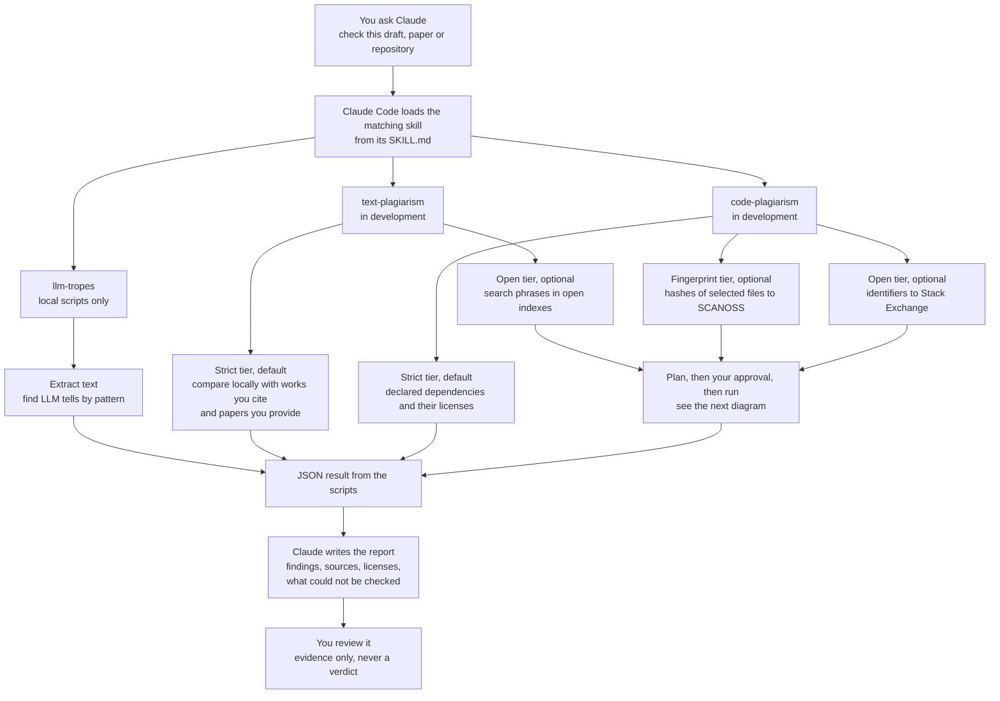
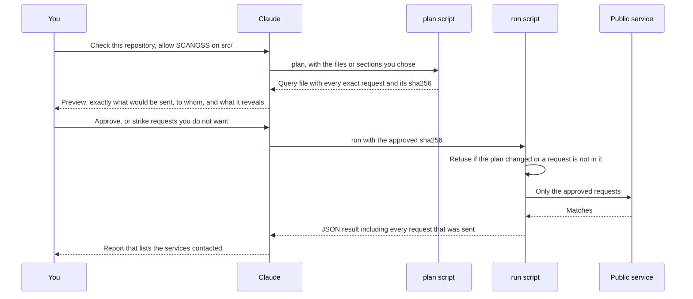

# research-scanners

Three Agent Skills for checking research writing and code, built for use with Claude Code and other agents that read `SKILL.md` skills. All three report **evidence only**: no accusation, no legal verdict, and no claim about who wrote something.

| Skill | What it does | Status |
|---|---|---|
| [`llm-tropes`](skills/llm-tropes/README.md) | Flags stylistic tells of LLM-written text, with line numbers and sources | Ready |
| [`code-plagiarism`](skills/code-plagiarism/README.md) | Finds code copied from Stack Overflow and open-source projects, with origin and license evidence | In development (hidden from installs) |
| [`text-plagiarism`](skills/text-plagiarism/README.md) | Finds passages copied verbatim from published papers and books, with source and attribution status | Planned (hidden from installs) |

The unfinished skills are marked `metadata.internal: true`, so installing "all skills" should today install only the finished one (per the CLI documentation, internal skills are hidden unless `INSTALL_INTERNAL_SKILLS=1` is set). When a skill is ready, that flag is removed and the same install command picks it up.

## Install

Requires Node.js (for `npx`) and Python 3.10 or newer (the skills run Python scripts). The installer is the open-source [`skills` CLI](https://github.com/vercel-labs/skills).

Install **all skills of this repository at once**, for Claude Code, in the current project:

```
npx skills add alvarobernal2412/research-scanners --skill '*' -a claude-code
```

Make them available in every project (user-level) by adding `-g`:

```
npx skills add alvarobernal2412/research-scanners --skill '*' -a claude-code -g
```

Other useful forms (see the CLI documentation for all options):

```
npx skills add alvarobernal2412/research-scanners --list                 # list what is available, install nothing
npx skills add alvarobernal2412/research-scanners --skill llm-tropes -a claude-code    # one skill only
npx skills add alvarobernal2412/research-scanners --all                  # all skills, all detected agents, no prompts
```

Then install each skill's Python dependencies once, for example `pip install -r skills/llm-tropes/requirements.txt` from the installed skill folder. Each skill's README lists its own requirements. The CLI documentation does not say whether supporting folders such as `scripts/` and `data/` are copied along with `SKILL.md`; check the installed folder after your first install.

Developing locally instead? Clone the repository and run `python tests/run_all.py` (needs `pip install -r requirements-dev.txt`).

## How they work

All three skills are instructions (`SKILL.md`) plus local Python scripts. Claude runs the scripts, reads their JSON output and writes the report. The two plagiarism skills can talk to public services, so they share one privacy rule: **nothing derived from your work leaves your machine unless you approved the exact request.**



The optional tiers go through the approval gate, which is how nothing is sent without your yes:



Notes:

- `llm-tropes` is fully offline. Its only optional network step checks cited DOIs against Crossref and sends nothing but the DOIs.
- The scripts cannot tell you from Claude: approval is relayed by Claude and also guarded by Claude Code's own permission prompt for running the script. The guarantee covers requests made by the skills' scripts; text that Claude reads is already in the model's context.
- Strict tier is the default for both plagiarism skills. It finds less by design and says what it could not check.

## Repository layout

```
skills/<name>/      what gets installed: SKILL.md, scripts/, data/, references/, README.md
tests/<name>/       tests and fixtures (not installed)
tests/run_all.py    runs each skill's tests in its own process
LICENSE, NOTICE     Apache-2.0, plus third-party material and its licenses
```

## License

Apache-2.0, see [`LICENSE`](LICENSE). Third-party material, including a data file derived from Wikipedia under CC BY-SA 4.0, is listed in [`NOTICE`](NOTICE).
