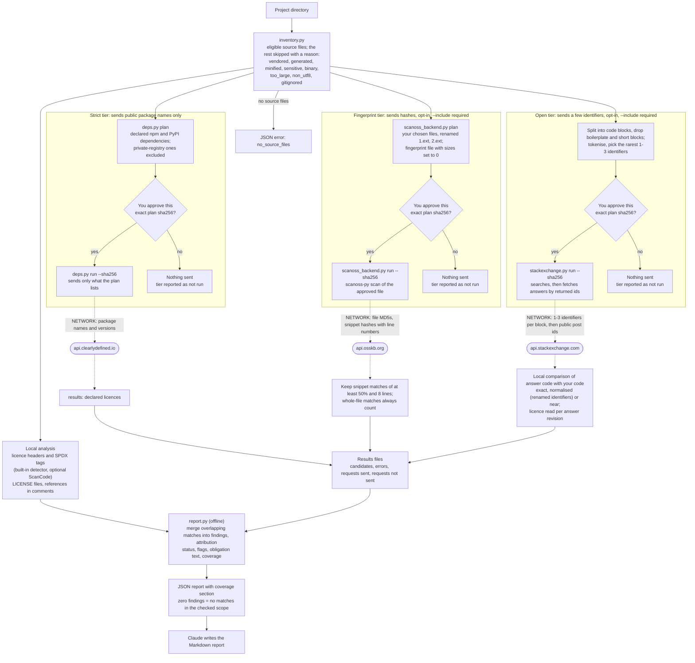

# code-plagiarism

An Agent Skill that checks a codebase for code taken from Stack Overflow answers, open-source projects and other licensed sources, and reports **evidence**: the candidate origins, the licence evidence (and where it comes from), whether attribution already exists in the file, the matched lines and what the licence asks of you. It never gives a legal verdict and never says who copied from whom.

## What it is for, and what it is not for

| Use it to | Do not use it to |
|---|---|
| Check your own project before you publish or ship it: did a snippet come from Stack Overflow or a GPL project, and is it credited? | Compare student submissions with each other |
| Find the exact lines, the candidate sources, the licence (per Stack Overflow revision, per file header) and the attribution text that licence asks for | Get legal advice or a verdict: the report is evidence of similarity and licence information |
| Review code you received, as one signal among others | Decide that someone copied code: similarity cannot show who copied from whom or which copy is the original |

## Use cases

| Scenario | What you get |
|---|---|
| A multi-line Stack Overflow answer pasted after May 2018, no attribution (C1) | A finding with the answer URL, author, date, licence CC BY-SA 4.0 (from the matching revision), flagged `unattributed`, with the attribution text the licence asks for |
| A snippet from an answer posted before May 2018 (C1b, C2) | The same, with the licence of the revision that holds the snippet (for example CC BY-SA 3.0 for an answer never edited since, 4.0 where a 2022 edit added the snippet). When revisions cannot be read, the answer's current licence and the date rule are both listed, marked as fallbacks |
| The same snippet with a comment that links the answer (C3) | The match is reported as **attribution present**, not flagged |
| A whole MIT file copied with its licence header intact (C4) | Header detected locally, licence MIT, attribution present, not flagged |
| A GPL function copied into an MIT project without notice (C5) | The candidate repository, GPL licence evidence with source and confidence, a `license_conflict` flag and a note that the licences differ; no verdict |
| A vendored copy of a declared dependency, for example `node_modules` (C6) | Not a finding: vendored files are never scanned; the declared dependency and its licence are listed instead |
| Getters, setters, imports, `main` stubs and a licence header alone (C7) | No finding (boilerplate and short blocks are dropped) |
| Code written for the test (C8) | "No matches found in the checked scope" plus what was and was not checked, never "clean" |
| A snippet whose only match is a repository with no licence file (C9) | Reported as "no licence found: all rights are reserved by default", never as public domain |
| A copy with renamed identifiers (C10) | The same finding with match type `normalised` (open tier; the fingerprint tier does not see renames) |

(C1 to C10 are the acceptance cases; the fixtures and their provenance are in the repository's test folder.)

### Example

Running `stackexchange.py` over a file with a pasted Stack Overflow answer returned: match `exact`, https://stackoverflow.com/a/58437909, author Scotty Jamison, revision 14, licence CC-BY-SA-4.0 (`so_revision`, high confidence), attribution `absent`, flag `unattributed`, with the sentence that begins "If copyrightable, reuse is governed by CC-BY-SA-4.0: credit the author ...". The same file with a renamed function and variables was found as `normalised`.

## How to use

Ask Claude, for example: "check this project for code copied from Stack Overflow or GPL projects" or "is this snippet attributed correctly?". Claude lists the files, runs the local checks, and offers the networked tiers one at a time. Each networked tier has a `plan` step and a `run` step:

```
python -I scripts/inventory.py <project>
python -I scripts/report.py <project>                                              # offline, local checks only
python -I scripts/deps.py plan <project> --out plan.json                           # strict tier
python -I scripts/scanoss_backend.py plan <project> --include src --out plan.json  # fingerprint tier
python -I scripts/stackexchange.py plan <project> --include src --out plan.json    # open tier
python -I scripts/approval.py strike plan.json --ids <id>,<id> --out plan2.json    # drop requests
python -I scripts/<backend>.py run plan.json --sha256 <hash> --out results.json    # only after your yes
python -I scripts/report.py <project> --results results.json [...]
```

`plan` writes every request it would make and prints a preview with a sha256. `run --sha256 <hash>` sends only what that plan lists and nothing at all if the hash does not match (the open tier's `run` also takes `--root <project>`). `--include` is required for the fingerprint and open tiers and has no default: you choose which files may be used. Put plan and results files outside the project. The output is JSON; Claude turns it into a Markdown report with a findings table and a coverage section.

## Pipeline



Dashed edges are the only places where data leaves the machine, and each of them sits behind the plan, approval, run gate. The approval is your yes, relayed by Claude, plus Claude Code's permission prompt for the `run` command; the scripts cannot tell you from Claude. `report.py` makes no network calls.

## Privacy: the three tiers and what leaves the machine

| Tier | Service | What leaves the machine |
|---|---|---|
| Strict (offered by default) | api.clearlydefined.io | Package name and exact version of declared direct dependencies (npm, PyPI), for example `npm/npmjs/-/is-odd/3.0.1`. Dependencies from a private registry, or with ranges or local/git specs, are not sent. No paths, no code, no project name |
| Fingerprint (opt-in, `--include` required) | api.osskb.org (SCANOSS) | One fingerprint file for the files you chose: files are renamed `1.ext`, `2.ext`, ... and sizes are set to 0, but it still carries the MD5 of each whole file, an MD5 of the file with line endings flipped, and about one 32-bit snippet hash per few lines **with the real line numbers**. No source text, but anyone holding the hashes can test whether a known file or passage is present. The service also sees your IP address and the client name. The preview shows the whole file before anything is sent |
| Open (opt-in, `--include` required) | api.stackexchange.com | 1-3 rare identifiers, hostnames or words per code block from the files you chose (up to four searches per block), then public post ids returned by the service. Anything that looks like a secret, key, e-mail address, IP address, internal host or path is never used. No API key unless you pass `--use-key` |

The exact wording shown before each tier, the quotas and the SCANOSS terms (identification only, professional use, usage may be logged) are in [`references/privacy.md`](references/privacy.md) and [`references/scanoss-terms.md`](references/scanoss-terms.md). Sensitive files (`.env*`, `*.pem`, `*.key`, `id_rsa*`, `credentials*`, `secrets*`), vendored directories and generated, minified, binary, oversized and non-UTF-8 files are never eligible. These guarantees cover what the scripts send. Text that Claude reads while helping you is already in the model's context.

## How to read a finding

- **Candidate origins** are places where similar code exists, listed with URL, author, date and revision. Several candidates in one finding are alternatives. A repository match can itself contain a copy of a Stack Overflow answer; the report says the origin is not established.
- **Licence evidence** gives the licence, where it came from (`so_revision`, `so_answer_current`, `so_date_rule`, `scanoss_component_declared`, `scanoss_license_file`, `clearlydefined`, a file header) and a confidence. A per-file header beats a repo-level LICENSE. No licence found means all rights reserved by default.
- **Attribution** is `present` (the file links the candidate or its header names the candidate's licence), `other_reference` (the file cites something else) or `absent`.
- **Obligation** is the licence's ask in plain words, always conditional ("if copyrightable"); it is not a legal opinion.
- **Match type**: `exact` (same tokens), `normalised` (same after renaming identifiers), `near` (similar, with the matched percentage), `file` (whole file).
- **Flags**: `unattributed`, `license_conflict` (a copyleft candidate licence that differs from the file's effective licence), `no_license_all_rights_reserved`. A flag is a reason to look.
- **Coverage** lists the tiers run, the services contacted, every request made, what failed or was not sent, what was skipped and what was not checked.

## Limitations

- **Public sources only.** Private or unpublished code is not found, and neither are renamed or restructured copies beyond token normalisation.
- **Short snippets are ignored by design**: code blocks with fewer than 6 significant lines, boilerplate, and SCANOSS snippet matches under 50% or under 8 lines. Whole-file matches always count.
- **The first SCANOSS match can be a copy rather than the origin.** SCANOSS's Stack Overflow data is a snapshot (about 2022). The open tier finds answers directly but is keyword search: it can miss a copy that exists (in the recorded fixture run it missed the C2 answer, whose only rare identifier returned 60 unrelated results).
- **Licences are per revision (Stack Overflow) or per file**, and the report is evidence, not a legal verdict. When revision bodies cannot be read the licence is the answer's current one, with the date rule as a lower-confidence fallback.
- **The strict tier finds little by design**: it lists declared direct dependencies with exact versions and their licences; it does not download dependency source or compare it. Only npm (`package.json`, `package-lock.json`) and PyPI (`requirements*.txt`, `pyproject.toml`) manifests are read. A private registry configured outside the files it reads (`[tool.hatch.index]`, `PIP_INDEX_URL` or `UV_INDEX_URL` in `.env`, CI files or Dockerfiles, npm settings in the environment, a home-directory `pip.conf`, configuration above the scan target) is not detected, so private dependency names there may be sent: review the preview and strike requests. Python older than 3.11 has no TOML reader, so dependencies in directories with `pyproject.toml`, `uv.toml`, `poetry.toml` or `Pipfile` are excluded.
- **ScanCode is optional.** Without it a built-in detector reads SPDX tags and common licence texts in the first 60 lines of each file.
- **Quotas.** Stack Exchange: 300 requests/day anonymous (default plan cap 30 searches, about 7 code blocks). SCANOSS anonymous: 5000 files/day, 7500/week, 15000/month (default plan cap 200 files).
- **Languages.** Source files in JavaScript/TypeScript, Java, C-family, C#, Go, Rust, Kotlin, Swift, PHP, Scala, Dart, Python, Ruby, shell, R and Perl; other file types are skipped with a reason.

## Quality checks

1015 automated tests (3 more are skipped where the platform lacks a feature they need, such as symlinks). They cover the inventory (binary, huge, minified, vendored and sensitive files, CRLF and BOM line numbers), licence and reference detection, tokenising and comparison (exact, renamed and near copies, boilerplate negatives, time budgets on hostile input), the plan/run gate (hash checks, byte-exact request matching, follow-ups only with returned ids, no secret in any plan, preview or log), each backend against recorded responses (no test touches the network; sockets are blocked), the report on the acceptance cases, and the documentation (every script and flag named in `SKILL.md` exists). Responses recorded live from public fixture code are in `tests/fixtures/responses/`.

`scripts/evaluate.py` scores the scanner on the labelled cases C1 to C10 (public fixtures with recorded provenance in `tests/fixtures/PROVENANCE.md`; labels in `tests/fixtures/cases.json`). A case counts as a true positive only when a flagged finding names the expected origin, licence evidence and attribution status. On the recorded responses (replay, no network):

| Tier | TP | FP | FN | TN | Not reachable by that tier |
|---|---|---|---|---|---|
| strict | 0 | 0 | 0 | 5 | 8 |
| fingerprint | 5 | 1 | 1 | 5 | 2 |
| open | 4 | 1 | 2 | 5 | 2 |
| all three | 7 | 1 | 1 | 5 | 0 |

The misses are reported as they are: C2 (a 2011 answer) is flagged by SCANOSS only as an MIT repository copy (counted as FP and FN) and the open tier does not find the answer, and the open tier alone scores C9 as FP and FN because it finds two Stack Overflow answers with the same class rather than the repository the label expects. These are small hand-picked fixtures, not a benchmark. `python -I scripts/evaluate.py tests/fixtures/cases.json --live --plans-dir <dir>` writes the plans and previews and sends nothing; `--live --plans-dir <dir> --approve <combined sha256>` runs them against the real services.

## License

Apache-2.0 (see the repository `LICENSE`). Test fixtures keep their original licences (Stack Overflow snippets under CC BY-SA 3.0/4.0, GPL and MIT files); they are used only for testing and are listed in `tests/fixtures/PROVENANCE.md`. The SCANOSS client (MIT) and ScanCode Toolkit (Apache-2.0) run as external processes and are not bundled.
