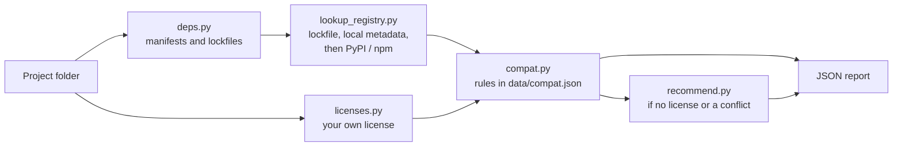

# license-compliance

Checks whether the licenses of your project's dependencies are compatible with the license of your project, lists the dependencies you cannot ship as they are, and, if your project has no license, recommends one and lists the licenses that are ruled out.

Report-only: it never edits files and does not give legal advice.

## Use cases

- "Can I release this library under MIT?" Every runtime dependency is checked against MIT.
- "My project has no license. Which one can I use?" The usable licenses are computed from the dependencies. Each ruled-out license is listed with the dependency that blocks it.
- "Does any dependency have no license?" Those are reported as not usable as-is (all rights reserved by default).

## How it works

## Privacy

Only the names and versions of packages from PyPI or npm are sent. Packages from git, local paths or URLs are never sent. `--offline` makes no requests. The report lists every request that was sent.

## Requirements

Python 3.10 or newer. No packages to install.

## Limitations

- Python (`requirements`, `pyproject.toml`, `Pipfile.lock`, `poetry.lock`) and npm (`package.json`, `package-lock.json`) only.
- Transitive dependencies need a lockfile or fully pinned requirements.
- Registry license fields are self-declared. Dual licenses expressed as several classifiers are flagged as ambiguous.
- The compatibility table approximates the FSF, SPDX and Apache guidance. It cannot know how you combine or distribute the code.
