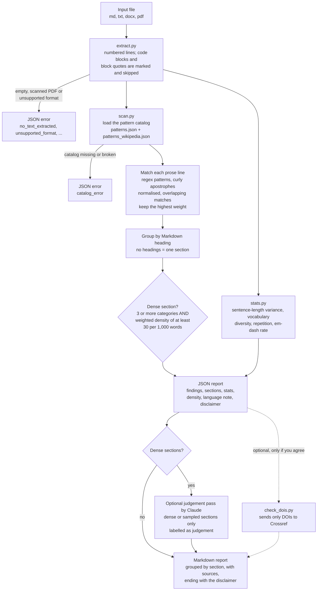

# llm-tropes

An Agent Skill that scans a text for the stylistic tells commonly associated with LLM output ("AI slop") and reports **evidence**: the matched line, the trope, its category and where the trope is documented. It never decides who wrote the text.

## What it is for, and what it is not for

| Use it to | Do not use it to |
|---|---|
| Self-check a draft, paper section, README, post or cover letter before sending it | Decide whether a person or an AI wrote something (it is not an AI detector) |
| Find the specific lines that read like boilerplate LLM prose, so you can rewrite them yourself | Rewrite or "humanise" the text (it only reports) |
| Review text you received, as one signal among others | Accuse anyone: the tells are descriptive and humans write them too |

## Use cases

| Scenario | What you get |
|---|---|
| You paste or point to an LLM-style paragraph ("In today's rapidly evolving landscape… it's not just X, it's Y… I hope this helps!") | The section is flagged **dense**: several trope categories co-occur at high density, with every matched line listed |
| You check ordinary human prose that uses "however", "moreover" and some em dashes | **Not dense.** A few low-weight hits may be listed, but isolated hits are not treated as a signal |
| A long human paper (thousands of words) with three ordinary stock phrases | **Not dense.** Density is measured per 1,000 words, so a few phrases in a long text do not trigger it |
| A single trope sentence such as "AI isn't just a trend — it's a fundamental shift" | The phrase is flagged as negative parallelism (single phrases are findings, but one phrase alone does not make a section dense) |
| Tropes appear inside a code block or a block quote (for example you quote an LLM) | **Ignored**: code and quoted text are not treated as your prose |
| Text with typographic apostrophes (Word, chat apps): "Here’s the kicker" | Still detected, and the original characters are kept in the report |
| Non-English text | No crash and no false flags; a `language_note` warns that the English patterns do not apply |
| A scanned PDF with no text layer, or an empty file | An explicit error (`no_text_extracted`), never a "clean" report |
| A paper with a reference list | Optional check that the cited DOIs resolve (see Network) |

### Example

A short LLM-style paragraph produced a dense section with 14 hits across four categories (lexical, structural, rhetorical, chatbot residue), at a section density of about 197 per 1,000 words. A plain human methods paragraph produced one low-weight hit ("Moreover,") at about 5 per 1,000 words and was not dense. These are two small samples, not a benchmark.

## How to use

Ask Claude, for example: "check this draft for LLM tropes" or "does this README sound like ChatGPT?". Claude runs the scanner and presents a Markdown report grouped by section. Directly:

```
pip install -r requirements.txt
python -I scripts/scan.py my-draft.md [--profile general|academic|technical|marketing]
```

Formats: Markdown, plain text, DOCX, PDF (with a text layer). The output is JSON; Claude turns it into a report with a table of line, matched text, trope, category and source for each section. `--profile` is accepted but currently changes nothing.

## Pipeline



The scanner itself is offline. The dotted branch is the only network use: it sends the DOIs found in the text, nothing else.

## How to read the result

- **Findings** are individual matches with line numbers.
- **Dense section**: three or more different trope categories in the same section *and* a high weighted density there. These are the places worth reading again.
- **Contested** findings, such as the em dash, are listed at low weight and never counted toward density.
- An optional **judgement pass** lets Claude look at dense sections for tropes a pattern cannot catch (false vulnerability, invented concept labels, stakes inflation). Those findings are labelled as judgement and are reading aids, not evidence.
- Every report ends with the disclaimer: it shows tell density and evidence only and does not establish authorship.

## What it checks

56 catalog entries in six categories: lexical (stock vocabulary, filler adverbs, copula avoidance, promotional register), structural (negative parallelism, rule of three, trailing "-ing" significance clauses, filler transitions, vague attribution), rhetorical (false suspense, teacher voice, stakes inflation), document level (signposted conclusions, repetition), formatting (em-dash overuse, bold-first bullets, emoji bullets) and chatbot residue ("I hope this helps", knowledge-cutoff disclaimers, `utm_source=` links). 39 entries are regex-detectable; the rest are statistical or judgement-only. Sentence-length variance, vocabulary diversity and repetition are computed as supporting statistics. Sources and licences for every entry are in [`data/ATTRIBUTION.md`](data/ATTRIBUTION.md).

## Network and privacy

The scanner is fully offline. The one optional exception is `scripts/check_dois.py`, which sends only the DOIs found in the text to `api.crossref.org` to check that cited references resolve; `--offline` guarantees no requests. The text itself is never sent anywhere by the scripts. (Text that Claude reads is already in the model's context.)

## Limitations

- **The signs are descriptive.** Humans write these phrases, good LLM output may show none, and tells change with model generations. A dense section is a reason to look, never proof.
- **Bias risk.** Detectors in general misclassify non-native English writers (Liang et al., https://arxiv.org/abs/2304.02819). Do not use this report to accuse anyone.
- **English only.**
- **Whole documents without headings are one section**, so a concentrated slop passage inside a long headless text can be diluted.
- **Known blind spots:** mid-line transitions ("…; Moreover,"), some regex literals and Rust lifetimes in the tokenizer, and tropes that need meaning rather than pattern (covered only by the optional judgement pass).
- **Calibration** (the density threshold of 30 per 1,000 words and 3 categories) rests on a few samples; labelled examples from your own writing would improve it.

## Quality checks

78 automated tests, including time budgets on hostile input (very long lines, huge files) and checks that scanned PDFs, empty files, code-only Markdown, CRLF/BOM files and non-English text behave sensibly. `scripts/evaluate.py` scores the scanner on labelled cases at the dense-section level.

## License

Apache-2.0 (see the repository `LICENSE`). `data/patterns_wikipedia.json` is derived from Wikipedia and stays CC BY-SA 4.0; MIT-licensed catalogues are credited in `NOTICE` and `data/ATTRIBUTION.md`.
