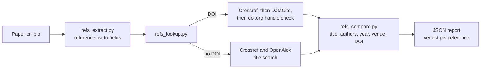

# reference-check

Checks that every reference in a paper exists and matches the real record: authors, title, year, venue and DOI are compared with Crossref, DataCite and OpenAlex. References that do not exist, or whose DOI belongs to a different work, are listed first.

Report-only. It says nothing about who or what wrote the paper.

## Use cases

- Before submitting: "do all my references resolve to the right work?"
- Reviewing a draft: "are any of these citations hallucinated?"
- Cleaning a `.bib`: find DOIs that point to the wrong paper or that do not exist.

## How it works

Verdicts: `verified`, `verified_with_differences`, `mismatch`, `doi_not_registered`, `not_found`, `unverifiable`, `lookup_failed`, `unchecked`.

## Privacy

For each reference the skill sends its DOI or arXiv id, or its title, first authors and year, to Crossref, DataCite, OpenAlex and doi.org. It never sends the paper's body text. The report lists every service contacted and every request. This still reveals the topic of the paper through its reference list. `--offline` sends nothing.

## Requirements

Python 3.10 or newer. `.docx` input needs `python-docx` and `.pdf` input needs `pdfplumber` (`pip install -r requirements.txt`). BibTeX, TeX, Markdown and text need nothing.

## Limitations

- Books, theses, standards and web pages are often unverifiable with these indexes.
- Free-text references are parsed heuristically, so a poorly formatted entry can produce a false `not_found`. BibTeX is reliable.
- `not_found` means "not found in the indexes queried", not "fabricated".
- It checks existence and match, not whether the cited work supports the claim.
