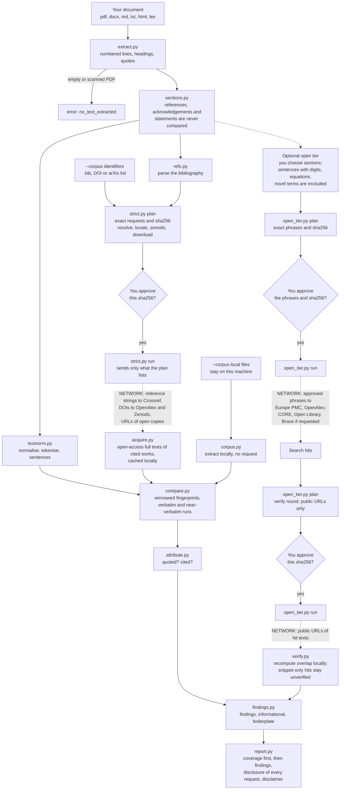

# text-plagiarism

An Agent Skill that checks a document (paper, thesis, report, draft) for passages copied verbatim or near-verbatim from published open-access work, and reports for each overlap the **source** (DOI or URL), its **license**, the **match length** and **how the passage is attributed**: quoted and cited, cited only, or unattributed. Every report opens with a **coverage** section that says what could not be checked.

It reports evidence only. It gives no legal verdict, no "percent plagiarised" score and no claim about who wrote the text.

## What it is for, and what it is not for

| Use it to | Do not use it to |
|---|---|
| Self-check a draft before submission: did I copy a cited paper without quotation marks? | Decide whether something is plagiarism or whether a copyright was infringed (that is a human and legal judgement) |
| Find passages that are close to verbatim copies of works you cite, with their license | Detect paraphrase or translation (not supported) |
| Review a text you received against papers you hold (`--corpus`) | Detect copying from unpublished or paywalled sources you cannot supply |
| Check your own text against your own earlier papers (reported as self-overlap) | Judge whether an AI wrote the text (use `llm-tropes`) or whether references exist (use `reference-check`) |

## Use cases

| Scenario | What you get |
|---|---|
| A passage copied unquoted from an open-access paper that is in your reference list | A finding with the DOI, license, version, match length and attribution `unattributed` (severity `flag`) |
| The same passage with a citation but without quotation marks | A finding `cited_not_quoted` (severity `light`), not "unattributed" |
| The passage inside quotation marks with a citation | Listed as informational (`quoted_cited`), not as a problem |
| A stock sentence found in many independent sources | Listed as boilerplate, not as a finding |
| An original sentence | No finding |
| The text appears only in the reference list, a footnote, acknowledgements or a statement | No finding: those parts are never compared |
| A scanned PDF with no text layer, or an empty file | An explicit error (`no_text_extracted`), never a report |
| Your own paywalled chapter, or any paper you cite that is not open access | Listed under coverage as not obtained, with the reason. Pass the PDF with `--corpus` and it becomes checkable, locally |
| Another author's unpublished draft that you hold | Pass it with `--corpus`: it is compared on your machine; the source is reported as `file:<name>` |
| Overlap with your own earlier paper | Reported as self-overlap (severity `light`) when the corpus manifest says `"relation": "own"` |

## How to use

Ask Claude, for example: "check this thesis chapter for copied passages" or "does this draft quote its sources properly?". Claude runs the scripts, shows you what would be sent, waits for your explicit yes, and then presents a Markdown report. Directly:

```
pip install -r requirements.txt
python -I scripts/prepare.py draft.pdf [--corpus papers/] [--corpus related.bib]
python -I scripts/strict.py plan --workdir W        # shows the next round and its sha256
python -I scripts/strict.py run  --workdir W --plan <plan file> --sha256 <hash>
# repeat plan/run until plan prints {"done": true}
python -I scripts/report.py --workdir W
```

Optional **open tier**: you choose which sections may be searched, see every exact phrase that would be sent, can strike requests (`approval.py strike`) or re-add excluded sentences by id, and approve:

```
python -I scripts/open_tier.py plan --workdir W --sections s2,s3 [--backends europepmc,openalex] [--include c4] [--use-keys]
python -I scripts/open_tier.py run  --workdir W --plan <plan file> --sha256 <hash>
python -I scripts/open_tier.py plan --workdir W     # next round: second OpenAlex window, then verification of hits
```

**`--corpus`** (repeatable) accepts a document file, a directory, a `.bib` file, a `.txt` list of DOIs, arXiv ids or URLs, and a `corpus.json` manifest `[{"file": "a.pdf", "doi": "...", "title": "...", "authors": "...", "year": 2020, "relation": "related" | "own"}]` that gives metadata for local files. Local files are compared on your machine and produce no request; identifiers are public identifiers and are fetched in the strict rounds.

## Pipeline



Dashed edges send data over the network. Everything else runs on your machine. The approval diamonds are the plan/run gate: a request that is not in the approved plan is refused before any connection is opened.

## What leaves your machine

- **Strict tier (default):** DOIs, arXiv ids, URLs of open copies and **reference-list strings** (published bibliographic data) to Crossref, OpenAlex, Zenodo and the hosts of open-access copies. Never a sentence of your document.
- **Open tier (opt-in per run):** only the phrases you saw in the preview and approved, to Europe PMC and OpenAlex (and CORE, Open Library or Brave if you ask), at most 10 sentences and 10 requests per backend per run. Verification then fetches the open text of each hit from its public URL.
- **Local corpus files:** nothing.
- Optional keys, all **off unless set**: `OPENALEX_API_KEY`, `CORE_API_KEY`, `BRAVE_API_KEY` (Brave is keyed-only), plus `TEXT_PLAGIARISM_MAILTO` (Crossref User-Agent) and `TEXT_PLAGIARISM_CACHE`. Open-tier requests carry no key or address on a keyless route unless you pass `--use-keys`. Plans store `{ENV_NAME}` placeholders, never values.
- The scripts cannot tell you from Claude: approval is relayed by Claude and gated by Claude Code's permission prompt on each `run` command. The guarantee covers only the scripts' own requests; text that Claude reads is already in the model's context.
- Downloaded open-access texts, the extracted text of your document and the request log are kept under your user cache directory, never in the repository.

## How to read the report

1. **Coverage** first: status (`findings`, `no_overlap_found_in_checked_sources`, `insufficient_coverage`), which cited works were checked and which could not be (by number and reason), unresolved references, corpus items, which sections were compared, how many sentences the open tier queried and how many it did not, backend errors, and the limits.
2. **Findings**: passage, location, source with DOI or URL, license, version, overlap length, attribution, severity (`flag` unattributed; `light` cited but not quoted, or quoted without citation), confidence.
3. Informational (quoted and cited), boilerplate, unverified candidates (search hits whose text could not be checked), a disclosure of every request sent, and a disclaimer.

"No overlap found" means only that nothing matched in the sources that could be checked.

## Limitations

- **Paywalled and unpublished sources cannot be checked** unless you supply them with `--corpus`. A cited work whose full text could not be obtained is listed under coverage with its reason; a publisher page that answers with a bot-challenge page counts as not obtained.
- **OpenAlex full-text search is stemmed**, covers a fraction of works (about 17% in the spike) and never found about 40% of true sentences in testing; zero results mean not covered, not absent. The keyless budget is shared and small.
- **Europe PMC** covers open-access biomedical literature only. **CORE** body-text coverage is unverified (opt-in). **Open Library** returns snippets only, so its hits are unverified candidates. The **Brave** response shape follows its documentation and was never recorded, because no key was available.
- **Paraphrase and translation are not detected.** Only verbatim and near-verbatim runs are reported: at least 12 words in total with at most 3 differing words between runs (8 words for hits the open tier verified).
- PDFs whose text extraction loses the spaces are detected and force `insufficient_coverage`; scanned PDFs are not read (no OCR).
- Thresholds are provisional constants until calibrated on your own cases. Precision and recall are measured only on the small labelled set in `tests/text-plagiarism/fixtures/cases/` (`evaluate.py`), which is not a benchmark.

## Quality checks

236 automated tests in `tests/text-plagiarism/` (run `python -m pytest tests/text-plagiarism -q`) never touch the network: sockets are blocked, HTTP is injected and answered from responses recorded once from the real services (`tests/text-plagiarism/fixtures/`, with provenance and licenses in `PROVENANCE.md`). They cover extraction, section detection, the winnowing overlap, attribution, the approval gate, the transport, every backend, the strict and open pipelines, the corpus, the report and the evaluation harness. `scripts/evaluate.py` scores labelled cases offline and checks three hard gates: privacy, honest coverage and no verdict.

## License

Apache-2.0 (see the repository `LICENSE`). Test fixtures quoted from CC BY 4.0 papers keep their license; see `tests/text-plagiarism/fixtures/PROVENANCE.md` and the repository `NOTICE`.
